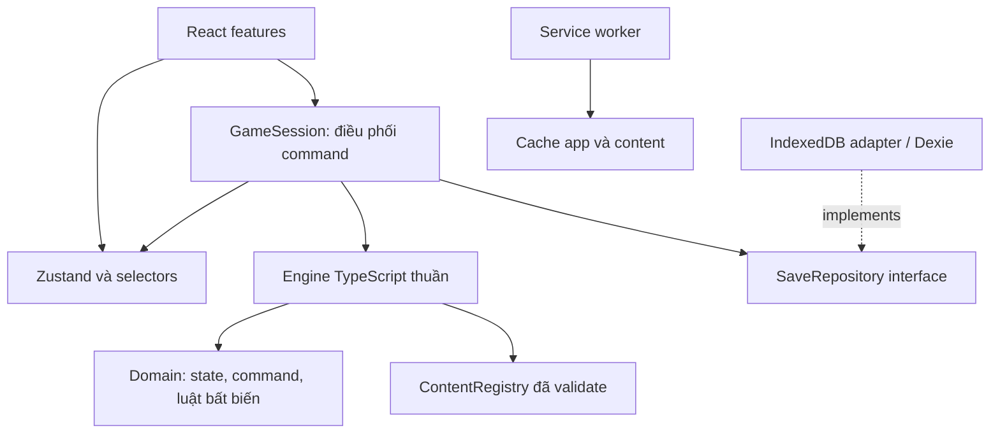
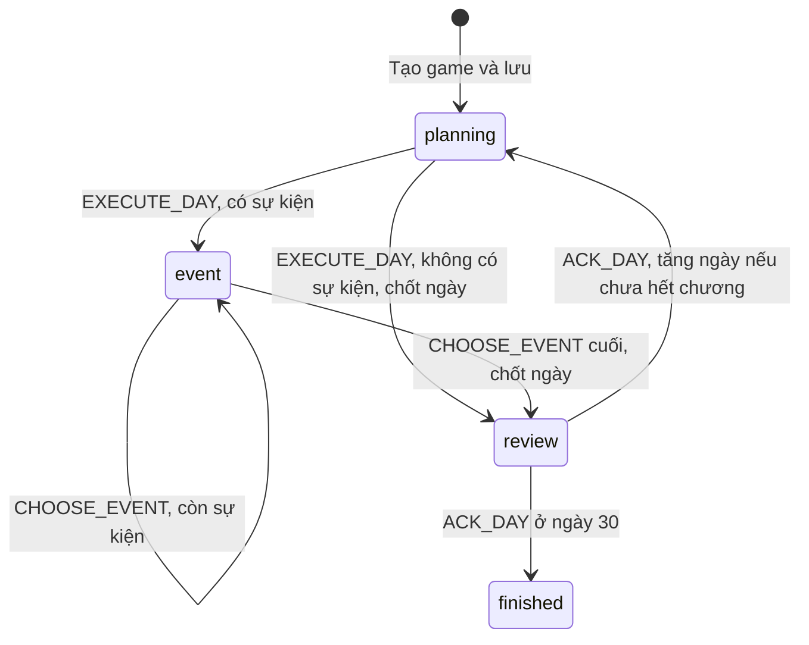

# Kế hoạch kiến trúc và xây dựng base code

**Dự án:** Nhật Ký Đi Nhật — Hành Trình Tha Hương  
**Nguồn:** `../# GAME DESIGN DOCUMENT (GDD).txt`, phiên bản 1.0  
**Ngày lập:** 08/11/2026  
**Trạng thái:** Đề xuất kỹ thuật để triển khai MVP

## 1. Kết luận triển khai

Xây một ứng dụng React + TypeScript + Vite + Zustand, với **engine mô phỏng viết bằng TypeScript thuần, tách khỏi giao diện**. MVP phải đi trọn vòng tạo nhân vật → ngày 1–30 → nhận lương đầu tiên → tổng kết chương 1 theo mục tiêu đã chọn.

Base code cần cung cấp được một vòng chơi thực tế, hệ thống sự kiện có điều kiện và hậu quả, cùng cơ chế lưu an toàn. Cấu trúc này cho phép bổ sung chương 2–5 và lượt chơi theo tuần sau MVP mà vẫn dùng lại quy tắc mô phỏng từng ngày.

Tài liệu này là kế hoạch xây dựng; cây thư mục và các đoạn TypeScript bên dưới là thiết kế đề xuất, chưa phải mã nguồn game đã được tạo hoặc chạy thử.

### 1.1. Hiện trạng đã kiểm tra

- Thư mục dự án hiện chỉ có GDD, chưa có source, package, cấu hình build hoặc test.
- File GDD kết thúc tại mục **5.7 — Các giá trị ẩn**, dòng cuối là “Số ngày thiếu tiền sinh hoạt”.
- Chưa có đặc tả chi tiết về hoạt động, lịch làm việc, công thức chỉ số, lương, chi phí, nội dung sự kiện, save/load và cách tính tổng kết.
- Vì vậy, các mục được ghi **đề xuất** dưới đây là quyết định kỹ thuật/gameplay để bắt đầu triển khai, có thể điều chỉnh qua playtest; chúng không phải yêu cầu đã có trong GDD.

### 1.2. Phạm vi MVP và phần để sau

| Hạng mục | MVP cần làm | Sau MVP |
|---|---|---|
| Thời gian | 30 ngày, một lượt quyết định theo ngày | Định hướng theo tuần, mô phỏng từng ngày bên trong |
| Tạo nhân vật | Tên, avatar, 3 hoàn cảnh, 3 mục tiêu | Khác biệt kinh tế giữa hoàn cảnh, điều chỉnh mục tiêu ở các mốc |
| Chỉ số | Tiền, thể lực, sức khỏe, stress, XP tiếng Nhật, quan hệ riêng từng NPC | Tay nghề và tiến trình nghề nghiệp sâu hơn |
| Công việc | Một lịch công việc cơ bản, làm thêm theo điều kiện | Nhiều nghề, đào tạo, thay đổi môi trường |
| Truyện | Sự kiện cố định, có điều kiện, ngẫu nhiên, hậu quả trễ | Chuỗi nhiệm vụ dài và toàn bộ chương 2–5 |
| Kinh tế | Cash, lương chờ trả, chi phí, khoản thiết yếu chưa thanh toán | Tiết kiệm/chuyển tiền và nghĩa vụ tài chính đầy đủ |
| Lưu trữ | Một autosave, bản trước đó, xuất/nhập JSON | Nhiều slot, đồng bộ thiết bị nếu có nhu cầu |
| Kết quả | Tổng kết khả năng thích nghi sau 30 ngày | Kết thúc hành trình ba năm |
| Phân phối | Web PC/mobile, chơi offline sau lần tải đầu | Các hình thức đóng gói khác nếu cần |

MVP dùng cùng chỉ số và tài chính khởi tạo cho cả ba hoàn cảnh, đúng mục 4.2 của GDD. Tuổi và quê quán có thể dùng giá trị mặc định hoặc thông tin trang trí; không tạo thêm hệ thống cân bằng từ hai trường này.

## 2. Các quyết định cần đưa vào cấu hình gameplay

Những giá trị dưới đây là **mặc định đề xuất** để đội phát triển có thể bắt đầu. Ghi chúng trong `content/balance.ts` và `content/calendar.ts`, không rải số trực tiếp trong component hoặc engine.

| Quyết định | Đề xuất ban đầu | Cần xác nhận bằng |
|---|---|---|
| Ngân sách hành động | Một hoạt động tùy chọn/ngày; ca làm cơ bản chạy theo lịch | Chơi thử 7 ngày xem số lựa chọn có đủ ý nghĩa |
| Hoạt động | Nghỉ, tự học, học có phí, gọi gia đình, giao lưu, làm thêm | Bảng chi phí/điều kiện/hiệu ứng |
| Lịch làm việc | Cấu hình rõ ngày làm, ngày nghỉ, ngày bắt đầu nhận việc và nghỉ phục hồi thay ca khi sức khỏe thấp | Timeline nội dung chương 1 và ngưỡng nghỉ ở M0 |
| Ngày trả lương | Lần đầu vào cuối ngày 30, trước tổng kết MVP | Test tính lương và nhịp thiếu tiền trước payday |
| Tiền ban đầu | Một mức chung đủ trang trải lối chơi cơ bản tới payday | Mô phỏng dòng tiền 30 ngày |
| Thiếu tiền | Chặn chi tùy chọn; khoản thiết yếu thiếu được ghi còn phải trả | Tình huống hỗ trợ, không kẹt vòng chơi |
| Sức khỏe thấp | Mở sự kiện hỗ trợ và nghỉ miễn phí; chưa thêm game over tức thì | Playtest nhánh làm việc quá sức |
| Sự kiện | Tối đa một sự kiện ngẫu nhiên/ngày; sự kiện bắt buộc vẫn xử lý đầy đủ | Ngân sách đọc và độ dài phiên chơi |
| NPC ban đầu | Lan, Sato, Haru, gia đình, lấy từ ví dụ trong GDD | Hồ sơ nhân vật và nội dung hội thoại |
| Tổng kết | Ba góc đánh giá theo mục tiêu, có thể đạt nhiều mặt cùng lúc | Rubric ghi rõ các điều kiện |

Chưa ấn định lương, sinh hoạt phí và xác suất bằng số trong kế hoạch này vì GDD chưa cung cấp. Nhiệm vụ M0 phải tạo bảng giá trị đầu tiên; các số đó là giả định cân bằng game, không phải dữ liệu lao động thực tế.

### 2.1. Các quy tắc bắt buộc giữ đúng GDD

- Cash và lương đã kiếm nhưng chưa nhận là hai số khác nhau.
- Energy, Health, Stress và điểm quan hệ từng NPC nằm trong `[0, 100]`.
- Japanese XP là số không âm, có thể lớn hơn 100; các mốc là 50, 120, 220, 350.
- Energy dưới 20 phải được xét rủi ro ở cuối ngày.
- Sức khỏe phục hồi chậm hơn thể lực; stress cao tạo bất lợi.
- Hành động có thể ảnh hưởng những sự kiện và cơ hội về sau.
- Kết quả phản ánh mục tiêu và hành trình, không chỉ tổng tiền.
- Các chương sau dùng lượt theo tuần nhưng vẫn tính chi phí, thu nhập và trạng thái theo ngày được mô phỏng.

## 3. Stack và phạm vi kỹ thuật

| Thành phần | Lựa chọn | Vai trò |
|---|---|---|
| UI | React + TypeScript | Form, dashboard, hội thoại, nhật ký và tổng kết |
| Build | Vite, template `react-ts` | Dev server và build static |
| State phía giao diện | Zustand | Công bố snapshot hiện tại, trạng thái tải/lưu và selectors |
| Engine | TypeScript thuần | Thực thi command và tính luật game |
| Kiểm tra dữ liệu | Zod | Kiểm tra content và save khi chạy |
| Save | IndexedDB qua Dexie | Snapshot và backup có transaction |
| Offline | `vite-plugin-pwa`, chế độ cập nhật có thông báo | Cache ứng dụng và nội dung chương 1 |
| Unit/integration | Vitest, `fake-indexeddb` | Engine, repository, migration |
| Kiểm thử trình duyệt | Playwright | Luồng chơi, reload, offline, mobile |
| Script nội dung | `tsx` | Validate content và chạy mô phỏng không cần UI |
| CSS | CSS thường hoặc CSS Modules, biến thiết kế dùng chung | Giao diện responsive với ít phụ thuộc |

Giữ một ứng dụng Vite duy nhất. DOM React đáp ứng gameplay lựa chọn và chỉ số; chưa cần canvas/game engine đồ họa, backend, tài khoản, đồng bộ mạng hoặc monorepo. Có thể điều hướng ba màn hình chính bằng state ứng dụng; chỉ thêm router nếu xuất hiện nhu cầu URL riêng.

Chọn Node.js thuộc nhánh LTS còn được hỗ trợ và đáp ứng `engines` của bộ Vite/Vitest được cài. Ghi phiên bản thực tế vào cấu hình dự án và commit lockfile khi bootstrap; không dùng dải “latest” làm cam kết tương thích lâu dài. Yêu cầu môi trường cần đối chiếu tại [Vite Getting Started](https://vite.dev/guide/) và [Vitest Getting Started](https://vitest.dev/guide/).

Bật `strict`, `noUncheckedIndexedAccess` và cân nhắc `exactOptionalPropertyTypes` từ đầu. `strict` cung cấp nhóm kiểm tra kiểu chặt hơn theo [tài liệu TypeScript](https://www.typescriptlang.org/tsconfig/strict.html).

## 4. Kiến trúc và chiều phụ thuộc



Chiều phụ thuộc trong code:

- `domain` không import React, Zustand, IndexedDB, DOM hoặc code hạ tầng.
- `engine` chỉ phụ thuộc `domain` và các contract nội dung thuần dữ liệu.
- `content` khai báo dữ liệu theo contract của domain; bootstrap tạo registry đã kiểm tra để truyền vào engine.
- `application` gọi engine, gọi repository và công bố state đã commit.
- `infrastructure` triển khai các interface lưu trữ; `app/bootstrap` ghép các thành phần.
- `features` dùng selectors và gửi command; không cộng tiền hoặc sửa chỉ số trực tiếp.

**Một nguồn sự thật:** `GameState` là trạng thái gameplay duy nhất. Tiền hiển thị, cấp tiếng Nhật, chương hiện tại và lựa chọn khả dụng được tính từ state/content bằng selectors. Trạng thái modal, tab, âm lượng và animation được lưu riêng.

### 4.1. Luồng của một quyết định

1. UI gửi một command kèm `commandId` và `expectedRevision`.
2. `GameSession` tuần tự hóa xử lý; engine kiểm tra phase, điều kiện và tài nguyên.
3. Engine tạo snapshot mới cùng các bản ghi nhật ký, không gây side effect.
4. Repository kiểm tra revision hiện tại và ghi snapshot + backup trong một transaction.
5. Sau commit thành công, Zustand công bố snapshot mới; UI cập nhật.
6. Nếu lỗi ghi/quota, giữ state đã commit trước đó, giữ ứng viên trong bộ nhớ để thử lại/xuất cứu hộ và chặn quyết định mới cho tới khi xử lý xong. Nếu lỗi revision do tab khác đã ghi, tải state mới và xử lý xung đột; không đổi revision của ứng viên cũ để ghi đè.

Command bị từ chối không thay state, không tăng revision và không tiêu trạng thái RNG. Timestamp và ID cho lượt chơi/command do lớp ứng dụng cấp; ID event instance/hậu quả trong engine sinh xác định từ `runId` và counter được lưu trong state. Không lấy đồng hồ máy hoặc gọi `Math.random()` trong engine.

## 5. Cấu trúc thư mục đề xuất

Đặt ứng dụng trong `game/` để có thể bootstrap Vite mà giữ nguyên GDD và tài liệu ở thư mục gốc.

```text
D:/project_web/
├── # GAME DESIGN DOCUMENT (GDD).txt
├── docs/
│   └── KE_HOACH_KIEN_TRUC_VA_BASE_CODE.md
└── game/
    ├── package.json
    ├── package-lock.json
    ├── index.html
    ├── tsconfig*.json
    ├── vite.config.ts
    ├── vitest.config.ts
    ├── playwright.config.ts
    ├── eslint.config.js
    ├── .gitignore
    ├── .editorconfig
    ├── README.md
    ├── public/
    │   ├── icons/
    │   └── assets/                  # Avatar, ảnh, font được đóng gói tại chỗ
    ├── scripts/
    │   ├── validate-content.ts
    │   └── simulate.ts
    ├── src/
    │   ├── main.tsx
    │   ├── app/
    │   │   ├── App.tsx
    │   │   ├── bootstrap.ts
    │   │   └── ErrorBoundary.tsx
    │   ├── domain/
    │   │   ├── model/
    │   │   │   ├── game-state.ts
    │   │   │   ├── character.ts
    │   │   │   ├── command.ts
    │   │   │   ├── condition.ts
    │   │   │   ├── effect.ts
    │   │   │   ├── story-event.ts
    │   │   │   └── save.ts
    │   │   ├── invariants.ts
    │   │   └── errors.ts
    │   ├── engine/
    │   │   ├── create-game.ts
    │   │   ├── execute-command.ts
    │   │   ├── day-cycle.ts
    │   │   ├── calendar.ts
    │   │   ├── rng.ts
    │   │   ├── conditions.ts
    │   │   ├── effects.ts
    │   │   └── systems/
    │   │       ├── activities.ts
    │   │       ├── economy.ts
    │   │       ├── wellbeing.ts
    │   │       ├── relationships.ts
    │   │       ├── story.ts
    │   │       ├── scheduler.ts
    │   │       └── goals.ts
    │   ├── content/
    │   │   ├── balance.ts
    │   │   ├── calendar.ts
    │   │   ├── backgrounds.ts
    │   │   ├── goals.ts
    │   │   ├── npcs.ts
    │   │   ├── activities.ts
    │   │   ├── chapter-01/
    │   │   │   ├── events.ts
    │   │   │   └── summaries.ts
    │   │   ├── registry.ts
    │   │   └── validate.ts
    │   ├── application/
    │   │   ├── game-session.ts
    │   │   ├── game-store.ts
    │   │   ├── ui-store.ts
    │   │   ├── selectors.ts
    │   │   └── ports/save-repository.ts
    │   ├── infrastructure/
    │   │   ├── persistence/
    │   │   │   ├── database.ts
    │   │   │   ├── indexeddb-save-repository.ts
    │   │   │   ├── save-schema.ts
    │   │   │   ├── migrations.ts
    │   │   │   └── import-export.ts
    │   │   └── offline/register-sw.ts
    │   ├── features/
    │   │   ├── character/CharacterCreation.tsx
    │   │   ├── dashboard/GameDashboard.tsx
    │   │   ├── activities/ActivityPanel.tsx
    │   │   ├── story/StoryDialog.tsx
    │   │   ├── journal/JournalPanel.tsx
    │   │   ├── summary/ChapterSummary.tsx
    │   │   └── settings/SaveSettings.tsx
    │   ├── shared/ui/               # Button, Dialog, StatBar, Money, Loading
    │   └── styles/                  # Tokens, global, responsive
    └── tests/
        ├── engine/
        ├── persistence/
        ├── e2e/
        └── fixtures/
```

Cây trên là đích của MVP. Tạo file khi chức năng tương ứng bắt đầu; không tạo hàng loạt file rỗng hoặc abstraction chưa có người dùng. Các module ngày/tuần, inventory và nghề nghiệp nâng cao chỉ bổ sung khi tới giai đoạn đó.

## 6. Mô hình dữ liệu gameplay

### 6.1. Các nhóm state

| Nhóm | Dữ liệu cần lưu | Lưu ý |
|---|---|---|
| `meta` | `runId`, `revision`, `lastCommandId`, `rulesVersion`, `contentVersion` | Phiên bản luật bao gồm engine và balance |
| `clock` | Ngày mô phỏng hiện tại, phase | Chương/mức kỹ năng được suy ra, tránh hai nguồn dữ liệu |
| `character` | Tên, avatar ID, hoàn cảnh, mục tiêu, energy, health, stress, Japanese XP | Avatar dùng ID asset, không nhúng file vào state |
| `economy` | Cash, unpaid wages, unpaid essential costs, các kỳ đã trả, ledger | Tất cả tiền là số nguyên JPY |
| `relationships` | Điểm riêng theo `NpcId` | Không có một điểm quan hệ chung |
| `work` | Trust, ngày đã làm thêm | Tổng làm thêm trong tuần được suy ra từ lịch sử ngày |
| `story` | Flags, lịch sử sự kiện/lựa chọn, promises, hậu quả đã hẹn, cooldown | Hậu quả đã thực hiện có dấu xử lý |
| `turn` | Hoạt động đã thực hiện, hàng đợi event instance, tổng kết ngày | Phục hồi đúng vị trí sau reload |
| `counters` | Số ngày thiếu tiền, chuỗi ngày kiệt sức nếu dùng | Mỗi ngày chỉ tăng một lần |
| `random` | Seed, trạng thái PRNG, phiên bản thuật toán | Phải serialize đầy đủ |
| `journal` | Quyết định, thay đổi đáng chú ý, mốc và nguyên nhân | Snapshot là nguồn khôi phục; journal phục vụ kể chuyện/debug |

Tên kiểu bên dưới là contract định hướng; các kiểu thành phần phải được khai báo ở module tương ứng khi xây base code.

```ts
type DayPhase = 'planning' | 'event' | 'review' | 'finished';

interface GameState {
  meta: GameMeta;
  clock: { day: number; phase: DayPhase };
  character: CharacterState;
  economy: EconomyState;
  relationships: Record<NpcId, number>;
  work: WorkState;
  story: StoryState;
  turn: TurnState;
  counters: GameCounters;
  random: RandomState;
  journal: JournalEntry[];
}

type GameCommand = {
  commandId: string;
  expectedRevision: number;
} & (
  | { type: 'EXECUTE_DAY'; activityId: ActivityId }
  | { type: 'CHOOSE_EVENT'; instanceId: string; choiceId: ChoiceId }
  | { type: 'ACK_DAY' }
);

type EngineResult =
  | { ok: true; nextState: GameState; notices: GameNotice[] }
  | { ok: false; error: GameRuleError };

function executeCommand(
  state: Readonly<GameState>,
  command: GameCommand,
  content: ContentRegistry,
): EngineResult;
```

`createGame(config, seed, runId, content)` là use case khởi tạo riêng. Kiểm tra tên, avatar, hoàn cảnh, mục tiêu tại biên dữ liệu; cả ba hoàn cảnh dùng cùng preset chỉ số trong MVP. Khởi tạo cũng phải lưu thành công trước khi cho phép chơi.

### 6.2. Quy tắc bất biến

- Chỉ số giới hạn được clamp theo luật khi áp dụng hiệu ứng hợp lệ; dữ liệu save nhập sai phạm vi phải bị phát hiện, không âm thầm sửa.
- Không cho `NaN`, số vô cực, tiền lẻ hoặc giá trị vượt miền số nguyên an toàn đi vào state.
- Không clamp cash về 0 để che chi phí thiếu; phần nghĩa vụ chưa trả phải tồn tại riêng.
- XP tiếng Nhật không âm và không có trần 100.
- Command chỉ hợp lệ ở phase phù hợp; chọn lại event đã kết thúc phải bị từ chối.
- `revision` tăng một lần cho mỗi command hợp lệ đã commit, kể cả command nội bộ xử lý nhiều bước.
- Không mutate state đầu vào, kể cả các object/array lồng nhau; `Readonly<GameState>` trong contract chỉ bảo vệ nông. Dùng kiểu readonly sâu hoặc quy ước immutable cùng fixture được freeze khi kiểm chứng.
- Hệ thống thu nhập, thanh toán, rủi ro và tăng ngày không được chạy trong React effect.
- Save là dữ liệu JSON thuần: không function, component, `Map`, `Set` hoặc đối tượng `Date` cần phục hồi đặc biệt.

## 7. Vòng ngày, thời gian và RNG

### 7.1. State machine MVP



**Thứ tự đề xuất, phải cố định trong `day-cycle.ts`:**

1. Ở `planning`, kiểm tra gộp ca làm và hoạt động tùy chọn trên một bản ứng viên. Điều kiện hoạt động được xét sau tác động ca làm dự kiến; không dùng clamp để che việc thiếu tài nguyên. Nếu không hợp lệ, trả lỗi và không thay state thật. Khi sức khỏe không cho phép làm ca, phải có kế hoạch nghỉ phục hồi thay ca theo ngưỡng M0; ca bỏ không tích lương. Hoạt động nghỉ thông thường chỉ phục hồi ngoài ca, không tự miễn ca làm.
2. `EXECUTE_DAY` thực hiện ca làm cơ bản nếu lịch yêu cầu và hoạt động tùy chọn. Ghi thu nhập vào `unpaidWages`, chi tùy chọn vào cash, cập nhật chỉ số.
3. Xác định hậu quả đến hạn, sự kiện theo kịch bản và tối đa một sự kiện ngẫu nhiên. Lưu các event instance đã chọn vào state, chuyển sang `event` nếu cần.
4. Mỗi `CHOOSE_EVENT` kiểm tra lại lựa chọn, áp dụng trọn gói chi phí/hiệu ứng/outcome, đánh dấu instance đã xử lý rồi chuyển tới sự kiện tiếp theo.
5. Khi hết hàng đợi, chốt ngày đúng một lần: xét rủi ro thể lực/stress **trước phục hồi giấc ngủ**; xử lý lương đến hạn; thanh toán chi phí thiết yếu đến hạn; cập nhật lời hứa/counter; phục hồi khi ngủ; tạo tổng kết ngày.
6. Chuyển sang `review`. `ACK_DAY` chỉ chuyển ngày hoặc sang `finished`, không chạy lại các hệ thống chốt ngày.
7. Tổng kết ngày 30 được tạo sau khi lương và chi phí ngày 30 đã xử lý; tổng kết chương lấy snapshot đã chốt này.

Sự kiện hỗ trợ do kết quả chốt ngày mới phát sinh được hẹn cho ngày kế tiếp. Riêng ngày cuối, tổng kết phản ánh tình trạng hiện tại và phương án hỗ trợ. Với mọi promise/hậu quả vượt ngày 30, validator chặn nội dung bắt buộc phải giải quyết để kết thúc MVP; nhánh có chủ đích tiếp diễn được giữ trong state và ghi ở tổng kết, không chặn hoàn thành chương vì chờ ngày 31.

Biên nhận “đã nhận lương” là notice trong `review` sau bước chốt tiền. Event có lựa chọn diễn ra trước chốt ngày chỉ được nói về lương sắp nhận và không tiêu khoản chưa trả. Công thức cụ thể và thời điểm từng nội dung có thể đổi ở M0 nhưng phải giữ một thứ tự duy nhất và test tương ứng.

Không có command công khai để UI gọi tùy ý từng bước như “cộng lương”, “ngủ”, “chốt thu nhập”. Việc chốt ngày là một phần chuyển trạng thái của engine; save chỉ thấy kết quả hoàn chỉnh của mỗi command.

### 7.2. Lịch ngày và mở rộng tuần

- MVP dùng số nguyên `day` từ 1 đến 30, cùng lịch làm việc và payday được cấu hình bằng ngày mô phỏng.
- Reset hạn mức theo tuần dựa trên `weekIndex = floor((day - 1) / 7)`, không dựa trên ngày thật của thiết bị.
- Trước khi xây chương 2, bổ sung ánh xạ ngày tuyệt đối sang lịch tháng/năm và cấu hình mốc chương. Chốt ngày bắt đầu/lịch cụ thể ở giai đoạn đó, không dùng giờ địa phương của máy để quyết định gameplay.
- Một tuần ở giai đoạn sau là bộ điều phối lặp xử lý ngày với một định hướng chung, không nhân hiệu ứng một ngày với 7.
- Khi gặp sự kiện bắt buộc giữa tuần, dừng, lưu số ngày còn lại và đợi lựa chọn; hoàn tất rồi mới tiếp tục.
- Ngày trả lương, khoản phí và mốc chương nằm giữa tuần vẫn được xử lý vào đúng ngày.

Base code chỉ cần thiết kế API ngày có thể tái sử dụng. Chưa triển khai scheduler tuần hoặc calendar đầy đủ trong MVP.

### 7.3. Ngẫu nhiên có thể tái hiện

- Dùng PRNG có seed và trạng thái nhỏ, thuần dữ liệu; chọn thuật toán và ghi phiên bản ngay ở M1.
- Cùng state, seed, chuỗi command, phiên bản content và rules phải cho cùng kết quả gameplay.
- Sắp xếp event theo ID ổn định trước khi bốc trọng số; quy định rõ quy tắc phá hòa priority.
- Event đã bốc phải nằm trong save. Mở lại hộp thoại không chọn sự kiện khác.
- Outcome ngẫu nhiên của lựa chọn được bốc khi thực thi command hợp lệ và commit cùng state RNG mới.
- Preview điều kiện/hiệu ứng không tiêu RNG. Metadata như thời điểm lưu không tham gia so sánh tính xác định.

## 8. Hệ thống sự kiện và hậu quả

### 8.1. Nội dung tách khỏi logic

Định nghĩa event trong TypeScript thuần dữ liệu ở giai đoạn đầu để có kiểm tra kiểu khi soạn. Dùng schema kiểm tra runtime để sẵn sàng nhập JSON sau này. Không cần xây công cụ biên tập sự kiện ngay trong MVP.

| Đối tượng | Trường tối thiểu |
|---|---|
| `ActivityDefinition` | ID, tên, điều kiện, chi phí, hiệu ứng, loại ngày được dùng |
| `EventDefinition` | ID, chương, loại trigger, điều kiện, priority, weight, cooldown, giới hạn số lần, nội dung, choices |
| `ChoiceDefinition` | ID, nhãn, điều kiện mở khóa, lý do khóa, chi phí, outcomes |
| `OutcomeDefinition` | Trọng số hoặc outcome chắc chắn, thông điệp, danh sách effects |
| `ActiveEventInstance` | Instance ID, event ID, phiên bản content, ngày xuất hiện, tham số và snapshot nội dung đang hiển thị |
| `ScheduledConsequence` | ID, ngày đến hạn, event/effects đích, trạng thái đã xử lý |
| `PromiseState` | ID, người liên quan, hạn, điều kiện hoàn thành, trạng thái và hậu quả |

Condition và effect dùng union có kiểm soát, không thực thi chuỗi biểu thức hoặc JavaScript từ dữ liệu:

```ts
type Condition =
  | { kind: 'all'; items: Condition[] }
  | { kind: 'any'; items: Condition[] }
  | { kind: 'not'; item: Condition }
  | { kind: 'compare'; metric: MetricRef; op: CompareOp; value: number }
  | { kind: 'flag'; id: FlagId; value: boolean }
  | { kind: 'eventSeen'; id: EventId };

type Effect =
  | { kind: 'statDelta'; stat: StatId; amount: number }
  | { kind: 'cashDelta'; amount: number; reason: string }
  | { kind: 'accrueWages'; amount: number }
  | { kind: 'relationshipDelta'; npcId: NpcId; amount: number }
  | { kind: 'setFlag'; id: FlagId; value: boolean }
  | { kind: 'scheduleEvent'; eventId: EventId; afterDays: number }
  | { kind: 'createPromise'; promise: PromiseDefinition };
```

`MetricRef` là union các chỉ số được cho phép, có nhánh riêng cho NPC và counter; không dùng đường dẫn string tùy ý để truy cập state. Chi phí được kiểm tra trên bản ứng viên trước khi áp dụng cả gói effect; tuyệt đối không trừ tiền rồi mới phát hiện choice không hợp lệ.

### 8.2. Chọn sự kiện và chống kẹt

1. Lấy hậu quả đến hạn và sự kiện bắt buộc theo lịch.
2. Thêm sự kiện có điều kiện đủ yêu cầu, theo chính sách ngân sách nội dung của ngày.
3. Lọc pool ngẫu nhiên theo điều kiện và lịch sử; bốc tối đa một event cho ngày. Cooldown/giới hạn lượt của event tùy chọn áp dụng cho mọi nguồn kích hoạt, kể cả điều kiện và lịch lặp, không chỉ random.
4. Đưa các instance vào hàng đợi ổn định theo priority và ID; không bỏ mất event bắt buộc khi đã có event ngẫu nhiên.
5. Mỗi event phải có ít nhất một lựa chọn an toàn không cần tiền hoặc điều kiện tài nguyên có thể mất đi. Lựa chọn bị khóa hiển thị lý do.
6. Hậu quả trì hoãn trong MVP phải có `afterDays >= 1`; không tạo chuỗi event đồng ngày vô hạn.

Mỗi lần kích hoạt có `occurrenceKey` xác định từ nguồn kích hoạt, ngày hoặc ID hậu quả; cùng key chỉ được enqueue một lần. Event tùy chọn đang pending được tính là đã dành lượt và không được enqueue trùng từ nguồn khác. Ghi lượt xuất hiện và bắt đầu cooldown ngay khi enqueue trong cùng snapshot, không chờ người chơi chọn xong.

Để đơn giản cho MVP, event bắt buộc không dùng cooldown/giới hạn lượt của pool tùy chọn; chống lặp bằng `occurrenceKey` và trạng thái hậu quả đã xử lý. Validator chặn việc dùng một định nghĩa có giới hạn tùy chọn làm đích bắt buộc, tránh âm thầm bỏ mất lời hẹn.

Điều kiện xuất hiện được chốt tại thời điểm enqueue và lưu nguyên nhân trong instance. Khi tới đầu hàng đợi, không bốc lại hoặc bỏ event vì state đã đổi bởi event trước; chỉ kiểm tra lại điều kiện/chi phí của từng choice. Fallback phải còn hợp lệ ở mọi trạng thái mà các event trước có thể tạo ra.

Validator phát hiện ID trùng, tham chiếu NPC/event/flag thiếu, trọng số không hợp lệ, cooldown âm, outcome rỗng, tổng trọng số bằng 0 và thiếu fallback. Mô phỏng nhiều state/seed bổ sung kiểm tra event có thể kết thúc; kiểm tra tĩnh không bảo đảm mọi tổ hợp điều kiện đều tới được.

### 8.3. Chuỗi mẫu cần có trong base code

- Ngày N: nhận làm thêm → tăng lương chờ trả, giảm energy, tăng stress, ghi lịch làm thêm.
- Hẹn lời mời giao lưu vào ngày N+2.
- Khi lời mời tới, lựa chọn tham gia yêu cầu energy đủ mức do balance quy định.
- Nếu quá mệt, vẫn có lựa chọn nghỉ/từ chối; journal ghi lại kết quả.
- Nếu tham gia, cải thiện quan hệ với NPC hoặc mở flag cơ hội sau này.

Chuỗi này chứng minh lời hứa cốt lõi của GDD: quyết định hôm trước có thể thay đổi cơ hội về sau. Save/load giữa hai sự kiện phải giữ nguyên hậu quả.

## 9. Kinh tế, chỉ số và tổng kết

### 9.1. Dòng tiền

```text
Ngày làm việc / làm thêm -> unpaidWages tăng
Đến payday              -> cash tăng, unpaidWages giảm tương ứng
Chi tùy chọn            -> chỉ dùng cash đang có
Chi thiết yếu           -> trả bằng cash; phần thiếu vào unpaidEssentialCosts
```

- Mỗi kỳ lương có ID; mỗi khoản thu/chi định kỳ có ID nghĩa vụ để chống xử lý lặp.
- MVP trả lương vào ngày 30 theo quyết định đề xuất ở mục 2. Ngày đó trả lương trước khi thu khoản thiết yếu cùng hạn.
- Quy định rõ cách thanh toán các khoản thiếu từ trước; đề xuất dùng cash còn lại sau khoản thiết yếu hiện tại để trả dần theo hạn cũ nhất.
- Ledger ghi ngày, loại, số tiền và nguyên nhân; không gộp “kiếm được” và “đã nhận” thành cùng một loại giao dịch.
- UI hiển thị cash, lương chờ trả và nghĩa vụ chưa thanh toán với nhãn rõ ràng.
- Mọi phép nhân lương/giờ phải có quy tắc làm tròn số nguyên; cấu hình ban đầu có thể dùng mức lương nguyên theo ca để đơn giản.

### 9.2. Thể lực và sức khỏe

`wellbeing.ts` chịu trách nhiệm về chi phí năng lượng, stress, rủi ro cuối ngày và phục hồi. Tách energy ngắn hạn khỏi health dài hạn; không dùng một thanh chỉ số cho cả hai. Các mức xác suất, tổn thất và phục hồi nằm trong balance.

Đánh giá energy trước ngủ để trạng thái 19 có ý nghĩa theo GDD. Cảnh báo ở UI và sự kiện hỗ trợ cần giải thích nguyên nhân, giúp người chơi ra quyết định ở ngày kế tiếp.

### 9.3. Mục tiêu và tổng kết ngày 30

Đề xuất tạo tập kết quả theo mục tiêu, thay vì một điểm tiền duy nhất:

- **Gia đình:** cash, nghĩa vụ chưa trả, khả năng duy trì sinh hoạt, quan hệ gia đình và lựa chọn hỗ trợ. Chưa tính chuyển tiền như tính năng đã tồn tại nếu chưa xây nó.
- **Sự nghiệp:** XP tiếng Nhật, trust nơi làm việc, mức độ đều đặn và các mốc học tập đã mở.
- **Trải nghiệm:** sức khỏe/stress, quan hệ và các trải nghiệm đã tham gia.

Tổng kết cho thấy cả thành tựu và đánh đổi, trích một vài lựa chọn quan trọng từ journal. Các ngưỡng đánh giá phải là dữ liệu cấu hình được viết ở M0/M3. Đây là tổng kết chương 1, không phải kết thúc toàn bộ hành trình ba năm.

## 10. Save/load, phục hồi và offline

### 10.1. Save contract

```ts
interface SaveEnvelope {
  schemaVersion: number;
  appVersion: string;
  savedAt: string; // Metadata hiển thị, không tác động thời gian game
  state: GameState; // Chứa runId, revision, contentVersion và rulesVersion
}

interface SaveRepository {
  load(): Promise<SaveEnvelope | null>;
  loadBackup(): Promise<SaveEnvelope | null>;
  commit(
    candidate: SaveEnvelope,
    expected: { runId: string; revision: number } | null,
  ): Promise<void>;
}
```

`expected = null` chỉ dành cho tạo save khi chưa có lượt hiện tại. Thay một lượt đang có bằng “chơi mới” hoặc nhập file phải dùng use case riêng, giữ bản trước và kiểm tra revision; không gọi ghi đè tùy ý.

Một snapshot đầy đủ là đủ để khôi phục. Journal và lịch sử choice không phải cơ chế event sourcing cần phát lại toàn bộ lượt chơi.

### 10.2. Quy trình lưu

- Lưu sau mỗi command hợp lệ, bao gồm lựa chọn event và xác nhận qua ngày.
- Ghi `current` và `backup` trong một transaction: backup nhận current thành công trước đó, current nhận ứng viên mới.
- Kiểm tra `runId + revision` trong cùng transaction để phát hiện tab khác đã ghi. Hàng đợi command trong từng tab chỉ giải quyết cạnh tranh nội bộ, không thay được kiểm tra tại database.
- Chỉ thông báo “Đã lưu” sau khi transaction commit. Không phụ thuộc vào `beforeunload` để lưu tiến trình quan trọng.
- Nếu mất điện/tab đóng trước commit, mở lại state cũ; nếu commit đã xong, mở state mới. Không có trạng thái cộng tiền một nửa.
- Nếu bấm lặp: `lastCommandId` cho phép nhận biết command vừa commit; `expectedRevision` và phase chặn bản lặp/cũ. Command xử lý một lần, không phát sinh thêm hiệu ứng.

Dexie hỗ trợ transaction và promise chỉ hoàn tất khi commit theo [tài liệu transaction](https://dexie.org/docs/Dexie/Dexie.transaction()). Tính ứng viên và validate ngoài transaction; bên trong chỉ thực hiện thao tác database liên quan, không đợi fetch hoặc timer.

### 10.3. Quy trình load và migration

1. Kiểm tra content của ứng dụng và dựng registry.
2. Đọc envelope, kiểm tra kích thước và cấu trúc cơ bản.
3. Nếu schema cũ được hỗ trợ, migrate từng phiên bản trên bản sao.
4. Kiểm tra toàn bộ schema state, invariants, ID nội dung, tương thích rules/content và event đang chờ.
5. Hydrate store rồi mới bật xử lý command. Giữ dữ liệu gốc cho tới khi migration mới được commit an toàn.
6. Nếu save hỏng, mở lựa chọn phục hồi backup hoặc xuất bản lỗi. Không tạo state mặc định rồi autosave đè save lỗi.
7. Save từ schema/content/rules tương lai hoặc chưa hỗ trợ phải được giữ nguyên và báo chưa tương thích. Không bỏ event hoặc flag không hiểu để tiếp tục âm thầm.

Khi đổi nội dung, giữ ID ổn định hoặc cung cấp migration/alias rõ ràng. `schemaVersion` giải quyết hình dạng dữ liệu, còn `contentVersion` và `rulesVersion` giải quyết khả năng tiếp tục câu chuyện và luật chơi.

Zustand `persist` có version/migration, nhưng kế hoạch dùng repository riêng cho gameplay để kiểm soát transaction và recovery. Có thể dùng `persist` cho tùy chọn UI nhỏ. Tài liệu [Zustand persist](https://zustand.docs.pmnd.rs/reference/middlewares/persist.html) cũng lưu ý deserialize JSON không tự kiểm tra dữ liệu; dùng schema runtime như [Zod](https://zod.dev/basics) tại biên save/content.

### 10.4. Xuất/nhập và xung đột

- Xuất JSON từ snapshot đã lưu, hoặc xuất ứng viên cứu hộ khi việc lưu thất bại; nhãn phải cho biết tình trạng.
- Import có giới hạn kích thước, parse/validate/migrate trước khi thay current; hiển thị tên nhân vật và ngày của file.
- Nội dung nhập chỉ được render như text; không thực thi HTML/script hoặc biểu thức trong file.
- Nếu hai tab cùng sửa, tab nhận lỗi revision chuyển sang trạng thái xung đột và tải snapshot mới trước khi cho chơi tiếp. Không thử lại ứng viên cũ với revision mới; chỉ tạo command mới trên state vừa tải nếu người chơi tiếp tục lựa chọn.
- Lỗi quota hoặc storage không khả dụng cần hiển thị rõ và cho xuất cứu hộ, không báo đã lưu giả.

### 10.5. Offline và cập nhật ứng dụng

- Precache HTML, JS, CSS, nội dung chương 1, avatar và font cần thiết. Nội dung MVP được đóng gói cùng build, không cần gọi API lúc chơi.
- Lần tải đầu cần mạng để cache hoàn tất; sau đó mở lại và chơi được khi ngắt mạng.
- Cache ứng dụng và database save có vòng đời riêng; cập nhật service worker không được xóa save.
- Dùng cơ chế thông báo bản cập nhật; chỉ tải lại sau khi command đã commit và ở điểm an toàn. [Vite PWA](https://vite-pwa-org.netlify.app/guide/prompt-for-update) cung cấp chế độ này.
- Test trên build production được phục vụ từ localhost/HTTPS, không dùng kết quả dev server để kết luận PWA đã hoạt động.
- Save cục bộ có thể mất khi người dùng xóa dữ liệu trình duyệt hoặc cơ chế quản lý dung lượng xóa dữ liệu; xuất/nhập là đường sao lưu cần có. Xem [quản lý dung lượng trình duyệt](https://developer.mozilla.org/en-US/docs/Web/API/Storage_API/Storage_quotas_and_eviction_criteria).

## 11. Giao diện MVP

| Màn hình/khu vực | Nội dung | Điều kiện hoàn thành |
|---|---|---|
| Khởi động | Tiếp tục, chơi mới, lỗi load/phục hồi | Không cho thao tác trước khi load xong |
| Tạo nhân vật | Tên, avatar, hoàn cảnh, mục tiêu, giới thiệu | Validate dữ liệu và khởi tạo đúng preset |
| Dashboard | Ngày, cash, lương chờ trả, khoản chưa trả, energy/health/stress/XP | Tách rõ trạng thái tài chính và chỉ số |
| Hoạt động | Hoạt động khả dụng, chi phí, tác động dự kiến, lý do khóa | Dữ liệu khả dụng lấy từ cùng luật engine |
| Sự kiện | Nội dung, choices, điều kiện khóa, phản hồi hậu quả | Focus bàn phím và không đóng để bỏ qua lựa chọn bắt buộc |
| Quan hệ/nhật ký | Điểm riêng NPC, lựa chọn/mốc gần đây | Tìm lại được nguyên nhân của hậu quả |
| Tổng kết ngày | Thay đổi đáng chú ý và nút sang ngày | Không chạy lại thu nhập hoặc chốt ngày |
| Tổng kết chương | Kết quả theo mục tiêu, các mốc và đánh đổi | Dừng đúng ngày 30 |
| Cài đặt lưu | Tình trạng lưu, xuất/nhập, phục hồi, thông báo cập nhật | Thao tác có phản hồi và xử lý lỗi |

Trên mobile 360px không có cuộn ngang; choices và nút qua ngày dễ chạm, dialog cuộn được và giữ focus hợp lý. Dùng text/icon ngoài màu sắc cho cảnh báo và thanh trạng thái. Chi tiết bộ nhớ, revision và PRNG chỉ xuất hiện trong công cụ debug, không đưa vào luồng chơi thường.

## 12. Danh mục base code cần xây trước

| Thứ tự | Gói công việc | File/module chính | Sản phẩm kiểm chứng được |
|---|---|---|---|
| B01 | Bootstrap và quy ước | Vite, TS, ESLint, README, scripts | Dev/build/typecheck chạy được |
| B02 | Domain, dữ liệu và version | `game-state`, `command`, `save`, invariants | State serialize/validate được |
| B03 | Khởi tạo và một ngày | `create-game`, `execute-command`, `day-cycle`, RNG | Chơi một ngày, xem thay đổi, qua ngày đúng một lần |
| B04 | Rule kinh tế/chỉ số | economy, wellbeing, relationships, balance | Cash/lương tách biệt, ngưỡng chỉ số đúng |
| B05 | Event engine | conditions, effects, story, scheduler, registry | Một choice bị khóa và một chuỗi hậu quả trễ |
| B06 | Persistence | Repository, IndexedDB adapter, save schema | Reload đúng ngày/phase/event, chống ghi lặp |
| B07 | React/Zustand | Bootstrap, session/store/selectors, các màn hình tối thiểu | Chơi được 3 ngày bằng UI với save thật |
| B08 | Nội dung và mô phỏng | Content validator, simulation script | Validate dữ liệu và tái hiện một lượt qua seed |

**Mốc hoàn thành base code:** chơi được ba ngày có công việc, nghỉ/học, một sự kiện phân nhánh, một hậu quả xuất hiện về sau và save/load giữa event. Các rule cơ bản có kiểm chứng, không còn logic cộng/trừ chỉ số nằm trong component.

Các script dự kiến trong `game/package.json`:

```json
{
  "dev": "vite",
  "build": "tsc -b && vite build",
  "preview": "vite preview",
  "typecheck": "tsc -b --pretty false",
  "lint": "eslint .",
  "test": "vitest run",
  "test:watch": "vitest",
  "test:e2e": "playwright test",
  "validate:content": "tsx scripts/validate-content.ts",
  "simulate": "tsx scripts/simulate.ts"
}
```

Đây là phần giá trị của `scripts`, không phải toàn bộ `package.json`. Bootstrap từ `D:/project_web` bằng `npm create vite@latest game -- --template react-ts`, sau đó cài và khóa bộ dependency tương thích trong `game/`. Lệnh này thuộc kế hoạch; chưa được thực thi trong yêu cầu lập tài liệu.

## 13. Lộ trình triển khai và điều kiện qua mốc

Ước lượng ban đầu **15–25 ngày công phát triển** cho một lập trình viên quen React/TypeScript, có người cung cấp/duyệt nội dung. Thời gian viết truyện, chờ duyệt, tạo mỹ thuật và playtest bổ sung có thể làm lịch dài hơn. Đây là ngày công, không phải 30 ngày trong game hay cam kết ngày phát hành.

| Mốc | Ước lượng | Công việc | Điều kiện chuyển mốc |
|---|---|---|---|
| M0 — Chốt vòng chơi | 1–2 ngày | Bảng action, lịch làm, cash/lương/chi phí, rủi ro, tổng kết; một chuỗi truyện mẫu | Có bộ balance đầu tiên và timeline đủ dựng ba ngày |
| M1 — Base chạy được | 2–3 ngày | B01–B04, B07 tối thiểu, model save và adapter bộ nhớ cho test | Một ngày hoàn chỉnh qua UI; command sai không sửa state |
| M2 — Truyện và lưu thật | 3–5 ngày | B05–B06–B08, hậu quả trễ, nhật ký; hoàn thiện base ba ngày rồi mở rộng bảy ngày | Reload giữa event không đổi kết quả; chuỗi lựa chọn có hậu quả; kiểm tra duplicate/payday bằng fixture |
| M3 — Hoàn chỉnh chương 1 | 4–6 ngày | Nội dung tới ngày 30, ba mục tiêu, giới thiệu ba hoàn cảnh, payday, tổng kết | Đi hết 30 ngày, không kẹt; tiền lương vào tổng kết đúng lúc |
| M4 — Offline và phục hồi | 2–4 ngày | PWA, import/export, backup recovery, migration, xung đột nhiều tab | Tiếp tục không mạng; save lỗi không bị ghi đè; cập nhật app an toàn |
| M5 — Kiểm chứng và cân bằng | 3–5 ngày | Mobile, bàn phím, mô phỏng nhiều seed, playtest ba lối chơi, sửa lỗi | Đạt bộ nghiệm thu ở mục 15 |

Save contract, load gate và khả năng serialize phải có từ M1; M4 hoàn thiện recovery/PWA, không chờ đến cuối mới thiết kế cách lưu.

Có thể làm song song sau khi chốt contract ở M0/M1:

- Người viết nội dung: NPC, ba phần giới thiệu, chuỗi sự kiện và thông điệp tổng kết.
- Người xây engine: command, kinh tế, wellbeing, condition/effect và scheduler.
- Người xây UI: layout, form, dashboard/dialog dựa trên fixture và selectors đã thống nhất.

Nếu chỉ có một lập trình viên, ưu tiên lát cắt chơi được từ đầu tới cuối trước khi mở rộng nội dung hoặc trau chuốt mỹ thuật.

## 14. Ngân sách nội dung ban đầu

Đây là đề xuất để 30 ngày có nhịp kể chuyện mà vẫn kiểm soát khối lượng:

- 3 giới thiệu hoàn cảnh và 3 mục tiêu chính, với mục tiêu phụ phù hợp từng hoàn cảnh.
- 4 hồ sơ quan hệ ban đầu theo danh sách NPC đề xuất.
- Khoảng 6 hoạt động tùy chọn và lịch công việc cơ bản.
- 12–18 định nghĩa sự kiện chính; phối hợp sự kiện theo lịch, theo trạng thái và sự kiện lặp có cooldown, không yêu cầu 30 truyện độc nhất.
- Ít nhất 3 chuỗi có hậu quả trễ để kiểm chứng ba trục tiền/công việc, học tập và quan hệ.
- Một thông báo nhận lương đầu tiên ở màn hình review sau chốt tiền và các phản hồi tổng kết theo ba mục tiêu.
- Trường hợp thiếu tiền, kiệt sức và sức khỏe thấp đều có cách tiếp tục chơi.

Mỗi event được coi là xong khi có ID, trigger/điều kiện, toàn bộ choices/outcomes, fallback, tác động, liên kết về sau và nội dung tiếng Việt đã duyệt. Validator chạy được chưa đồng nghĩa nội dung đã cân bằng hoặc đủ hấp dẫn.

## 15. Kiểm chứng và nghiệm thu

### 15.1. Kiểm tra tự động có giá trị

| Nhóm | Tình huống phải kiểm chứng |
|---|---|
| Tính xác định và immutable | Cùng seed/state/command/version cho cùng state và journal; preview không đổi RNG; nested state đầu vào không bị sửa |
| Khởi tạo | Ba hoàn cảnh cùng chỉ số/tài chính MVP; dữ liệu form không hợp lệ bị chặn |
| Lựa chọn | Thiếu cash/energy, phase sai, revision cũ hoặc choice cũ không gây hiệu ứng |
| Tiền | Unpaid wages không tiêu được; payday và phí định kỳ chỉ chạy một lần; nghĩa vụ thiếu được giữ lại |
| Chỉ số | Energy 19/20; các mốc XP 49/50, 119/120, 219/220, 349/350; XP vượt 100 bình thường |
| Quan hệ | Tác động lên Lan không tự thay điểm Sato; mọi điểm giữ trong giới hạn |
| Hậu quả | Lịch hẹn, promise/cooldown và event instance tồn tại qua save/load; không enqueue trùng; nhánh vượt ngày 30 tuân thủ chính sách kết thúc |
| Kết ngày | Chốt ngày một lần; ngủ sau kiểm tra kiệt sức; ngày 30 nhận lương trước tổng kết |
| Persistence | Reload giữa event; commit lỗi không công bố state mới; transaction giữ current/backup nhất quán |
| Migration/import | Fixture schema cũ, dữ liệu hỏng, ID thiếu, phiên bản tương lai, file quá lớn |
| Đồng thời | Double-click và hai tab cùng revision không nhân thu nhập hoặc ghi đè bản mới |
| Nội dung | Không ID trùng/tham chiếu thiếu; mỗi event có fallback và outcome hợp lệ |

Sử dụng Vitest cho engine/repository và Playwright cho những luồng cần trình duyệt thực theo [tài liệu Playwright](https://playwright.dev/docs/writing-tests). Không cần viết test lặp lại markup hoặc kiểm tra từng phép cộng đơn giản; tập trung các bất biến, giao dịch và kết quả người chơi quan sát được.

### 15.2. Mô phỏng và playtest

- Script chạy hết 30 ngày với nhiều seed và các chính sách chọn hành động: ưu tiên tiền, học tập, cân bằng, tiết kiệm tối thiểu.
- Báo cáo tỷ lệ hoàn thành, số ngày thiếu tiền, phân bố chỉ số cuối kỳ, số event xuất hiện và nhánh không được chạm tới.
- Bộ kiểm tra sơ bộ có thể bắt đầu với 100 seed/policy; tăng khi có vấn đề hoặc cần phân tích cân bằng, không xem đây là bảo đảm mọi trạng thái đều đúng.
- Kiểm tra seed xấu nhất phát hiện được, không chỉ xem số trung bình.
- Chơi tay ít nhất ba hướng mục tiêu; kiểm tra lựa chọn có đánh đổi rõ và nhật ký giải thích được hậu quả.

### 15.3. Checklist chấp nhận MVP

- [ ] Tạo nhân vật, chọn hoàn cảnh/mục tiêu và đi hết ngày 1–30.
- [ ] Ba hoàn cảnh chỉ thay giới thiệu/mục tiêu phụ trong MVP.
- [ ] Dashboard tách cash, lương chờ trả và khoản chưa thanh toán.
- [ ] Có công việc, học tập, nghỉ và tương tác xã hội với đánh đổi quan sát được.
- [ ] Có lựa chọn bị khóa kèm lý do và hậu quả ảnh hưởng ngày sau.
- [ ] Quan hệ được quản lý riêng theo NPC; XP/ngưỡng energy đúng GDD.
- [ ] Không có tình huống thiếu tiền/sức khỏe thấp khiến không thể tiếp tục.
- [ ] Reload ở planning, event và review đều phục hồi đúng vị trí.
- [ ] Double-click/reload không nhận lương, trả phí hoặc áp dụng choice hai lần.
- [ ] Save lỗi có đường phục hồi; import/export và xung đột tab được xử lý.
- [ ] Sau lần tải đầu, reload và chơi được đầy đủ khi ngắt mạng.
- [ ] Mobile 360px và thao tác bàn phím sử dụng được các luồng chính.
- [ ] Ngày 30 dừng đúng tổng kết chương 1, phản ánh mục tiêu và các lựa chọn.
- [ ] `typecheck`, `lint`, `validate:content`, test, build và các E2E cốt lõi đều qua.

## 16. Rủi ro và cách kiểm soát phạm vi

| Rủi ro | Cách xử lý trong kế hoạch |
|---|---|
| GDD hiện chưa đủ quy tắc để code thống nhất | M0 tạo bảng quyết định, balance và ví dụ một ngày trước khi mở rộng |
| Lương cuối tháng khiến người chơi hết tiền quá sớm | Mô phỏng dòng tiền, chỉnh preset/chi phí, có nghĩa vụ chưa trả và sự kiện hỗ trợ |
| UI và engine tính điều kiện khác nhau | Selectors dùng cùng evaluator; engine luôn kiểm tra lại command |
| Ngẫu nhiên làm lỗi khó tái hiện | Lưu seed, PRNG state và version; script chạy lại chuỗi command |
| Save sau cập nhật mất event hoặc sai luật | Tách schema/content/rules version, giữ ID, migration và fixture tương thích |
| Viết truyện vượt tiến độ | Khóa ngân sách nội dung, làm chuỗi mẫu trước, tái dùng sự kiện có cooldown |
| Xây đủ ba năm ngay khiến base phình lớn | MVP 30 ngày; giữ contract ngày để mở rộng tuần, chưa xây chương sau |
| Mô phỏng thành grind vì luôn lặp một hành động tối ưu | So sánh nhiều chính sách, hậu quả trễ và rubric nhiều mục tiêu, playtest đánh đổi |

## 17. Thứ tự bắt đầu ngay khi chuyển sang triển khai

1. Tạo bảng balance/lịch/hoạt động và timeline ba ngày đầu từ các mặc định ở mục 2.
2. Bootstrap `game/`, cấu hình TypeScript và các script kiểm tra.
3. Khai báo GameState/command/save schema và viết engine một ngày với seed cố định.
4. Nối UI tối thiểu; kiểm chứng cash và unpaid wages tách biệt.
5. Thêm event có lựa chọn khóa và hậu quả ở ngày sau.
6. Nối IndexedDB bằng transaction, kiểm tra reload giữa lựa chọn và gửi command lặp.
7. Chốt mốc base code ba ngày, rồi mở rộng bảy ngày và toàn bộ MVP theo roadmap.

Sản phẩm của gói đầu tiên phải là một vòng chơi nhỏ đã nối engine, nội dung, giao diện và lưu trữ, đủ làm nền cho chương 1.
